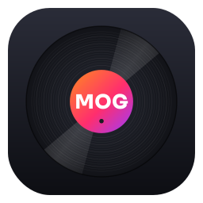

# MusicOrganizer (MOG)

Musikarchiv-Verwaltung für DJs – für **Windows 10/11 x64** und **macOS Sequoia** (Apple Silicon & Intel).



## Funktionen (Version 0.2)

Alle Änderungen je Version: siehe [CHANGELOG.md](CHANGELOG.md).

| Bereich | Was MOG kann |
|---|---|
| **Einlesen** | Ganzen Datenträger (z. B. externe SSD), einzelne Ordner oder einzelne Dateien – auch per Drag & Drop. Unveränderte Dateien werden beim erneuten Einlesen übersprungen, abgesteckte Laufwerke werden als „nicht erreichbar“ markiert statt gelöscht. macOS-Hilfsdateien (`._*`) und Systemordner werden ignoriert. |
| **Formate** | MP3, FLAC, WAV, AIFF, M4A (AAC/ALAC), OGG, Opus, WMA, APE, WavPack, Musepack, DSD (DSF/DFF), TTA, MP2, Speex |
| **Liste** | Spalten Artist, Titel, BPM, Länge, Qualität (kbps, farbig: grün = verlustfrei, gelb = mittel, rot = < 160 kbps), Format-Badge. Alle Spalten auf-/absteigend sortierbar. Weitere Spalten (Tonart, Album, Genre, Jahr, Label, Samplerate, Größe, Pfad) per Rechtsklick auf den Spaltenkopf einblendbar. |
| **Seitenleiste** | Alle Titel, Quellen (Laufwerke/Ordner), intelligente Ansichten: Verlustfrei, Niedrige Qualität, Ohne BPM, Fehlende Tags, Nicht erreichbar |
| **Duplikate** | Drei kombinierbare Methoden: gleiche Tags (Artist + Titel + Länge ±Toleranz), byte-identische Dateien, Audio-Fingerabdruck (Chromaprint – findet auch falsch getaggte Kopien und andere Formate). „Automatisch markieren“ behält pro Gruppe die beste Datei. Löschen von der SSD – in den Papierkorb oder endgültig. |
| **Tags** | Editor für einen oder viele Titel (Stapelbearbeitung), Cover laden/entfernen, „Aus Dateiname“, Artist ↔ Titel tauschen |
| **Online-Tags** | MusicBrainz, Discogs (ideal für Label/Genre/Stil), Spotify, AcoustID (Erkennung am Klang). Auswählbar, welche Felder übernommen werden; Cover-Übernahme. |
| **BPM** | Lokale Tempo-Analyse mit rekordbox-ähnlichen Bereichen (z. B. 78–155, 88–175) |
| **Konvertieren** | ffmpeg ist eingebaut: MP3 320/V0/256/192, AAC, ALAC, FLAC, WAV/AIFF 16/24 Bit, Ogg, Opus. Tags & Cover werden übernommen, parallele Verarbeitung. |
| **Große Archive** | Schnell auch bei 350.000+ Titeln: Bibliothek lädt im Hintergrund, Sortieren und Suchen in Sekundenbruchteilen. „Bibliothek → Bibliothek leeren“ setzt alles zurück (Dateien bleiben unberührt). |
| **Ungespeicherte Änderungen** | Tag-, Online- und BPM-Änderungen werden vorgemerkt (orange), mit „Speichern“ (Strg+S) oder beim Beenden nach Rückfrage in die Dateien geschrieben – oder verworfen. |
| **Dateinamen** | Umbenennen (F2) einzeln oder per Muster aus den Tags, mit Vorschau und Prüfung |
| **Spalten** | Breite und Reihenfolge frei veränderbar (Drag & Drop oder Rechtsklick auf den Spaltenkopf) |
| **Updates** | Prüft beim Start auf neue Versionen und installiert sie auf Wunsch (Extras → Nach Updates suchen) |
| **Player** | Integriert (Qt Multimedia/FFmpeg), spielt alle Formate. Leertaste = Play/Pause, Enter = Abspielen, Alt+←/→ = 10 s spulen. Ausgabegerät, Testton und Wiedergabe-Technik unter Extras → Einstellungen → Audio. |

**Tastenkürzel:** Strg/⌘+F Suche · Strg/⌘+E Tags · F2 Umbenennen · Strg/⌘+S Speichern · Strg/⌘+K Online-Tags · Strg/⌘+D Duplikate · Strg/⌘+O Ordner · Entf Löschen · Strg/⌘+Q Beenden

## Starten aus dem Quellcode

Voraussetzung: [Python 3.12](https://www.python.org/downloads/) (unter Windows bei der Installation „Add to PATH“ anhaken).

```bash
cd MusicOrganizer
python -m venv .venv
# Windows:  .venv\Scripts\activate
# macOS:    source .venv/bin/activate
pip install -r requirements.txt
python -m mog
```

## Fertige Programme bauen

### Variante A – automatisch über GitHub (empfohlen)
1. Projekt in ein GitHub-Repository hochladen.
2. Unter **Actions → Build MusicOrganizer → Run workflow** starten – oder ein Tag `v0.1.0` pushen.
3. Nach ca. 10 Minuten liegen unter dem Lauf die Downloads bereit:
   - `MusicOrganizer-<Version>-Windows-x64-Setup.exe` (Installer) + portable ZIP
   - `MusicOrganizer-<Version>-macOS-x86_64.dmg` (Intel; läuft per Rosetta auch auf Macs mit Apple-Chip M1–M4 – ein eigener Apple-Chip-Build ist vorerst deaktiviert, siehe `.github/workflows/build.yml`)

Bei einem Tag `v…` wird automatisch ein GitHub-Release mit allen Dateien erstellt.

### Variante B – lokal
- **Windows:** `packaging\build_windows.bat` (optional vorher [Inno Setup 6](https://jrsoftware.org/isinfo.php) installieren, dann entsteht auch ein Installer)
- **macOS:** `bash packaging/build_macos.sh` → `dist/MusicOrganizer.app` und eine `.dmg`

### Erster Start
- **Windows:** SmartScreen meldet evtl. „Unbekannter Herausgeber“ → *Weitere Informationen → Trotzdem ausführen*.
- **macOS Sequoia:** Die App ist nicht notariell beglaubigt. Beim ersten Öffnen blockiert macOS → *Systemeinstellungen → Datenschutz & Sicherheit → „Dennoch öffnen“*. macOS fragt außerdem einmalig nach Zugriff auf externe Laufwerke – bitte erlauben.

## Online-Datenbanken einrichten (Einstellungen → Online-Datenbanken)

| Dienst | Was nötig ist | Hinweis |
|---|---|---|
| MusicBrainz | nichts (Kontaktangabe empfohlen) | max. 1 Anfrage/Sekunde |
| Discogs | kostenloser persönlicher Token (discogs.com → Einstellungen → Entwickler) | beste Quelle für Label, Genre, Stil |
| Spotify | eigene App unter developer.spotify.com → Client-ID + Secret | Seit Feb. 2026 braucht der App-Inhaber Spotify Premium. BPM/Audio-Features gibt es für neue Apps seit Nov. 2024 nicht mehr, Album-Labels wurden entfernt – daher analysiert MOG BPM lokal. |
| AcoustID | kostenloser API-Key (acoustid.org/new-application) | erkennt Titel ohne Tags am Klang |

## Projektstruktur

```
mog/
  app.py               Start, Theme, Übersetzungen
  core/                ohne Oberfläche, separat testbar
    scanner.py         Einlesen (Laufwerk/Ordner/Dateien), Änderungserkennung
    tags.py            Tags lesen/schreiben für alle Formate (mutagen)
    library.py         Bibliothek (SQLite)
    duplicates.py      Duplikaterkennung (Tags, Hash, Fingerabdruck)
    encoder.py         ffmpeg-Konvertierung
    bpm.py             BPM-Analyse
    fingerprint.py     Chromaprint/fpcalc
    fileops.py         Löschen (Papierkorb/endgültig), im Finder/Explorer zeigen
  online/providers.py  MusicBrainz, Discogs, Spotify, AcoustID
  ui/                  Oberfläche (PySide6)
  resources/           Logo, Icons
packaging/             PyInstaller-Spec, Build-Skripte, Installer
tools/                 Logo-/Icon-Generator, fpcalc-Download
tests/                 Testdateien-Generator, Kern- und Oberflächentests
```

Bei Problemen (z. B. kein Ton) hilft das Diagnose-Protokoll `mog.log` (Extras → Diagnose-Protokoll zeigen). Die Bibliothek liegt unter `%APPDATA%\MOG\MusicOrganizer\library.sqlite` (Windows) bzw. `~/Library/Application Support/MOG/MusicOrganizer/` (macOS).

## Tests

```bash
python tests/make_samples.py /tmp/mog_samples      # erzeugt Testdateien in 9 Formaten inkl. Duplikaten
python tests/test_core.py /tmp/mog_samples         # Tags, Cover, Konvertierung, Löschen
QT_QPA_PLATFORM=offscreen MOG_NO_AUDIO=1 python tests/ui_smoke.py /tmp/mog_samples /tmp/shots
```

## Lizenzen von Drittkomponenten
- Qt / PySide6 – LGPL v3
- FFmpeg (über imageio-ffmpeg) – GPL/LGPL; bei Weitergabe der fertigen App die FFmpeg-Lizenz beilegen
- Chromaprint / fpcalc – LGPL 2.1
- mutagen – GPL v2+
- Logo-Schrift Sora – SIL Open Font License (nur zur Logo-Erzeugung, `tools/fonts/`)

## Ideen für die nächsten Schritte
- rekordbox-XML-Export/-Import (Playlists, Cues, BPM)
- Wellenform-Anzeige im Player, Cue-Punkte
- Tonart-Erkennung (Camelot)
- Ordner-Umbenennung nach Tag-Muster (z. B. `Genre/Artist - Titel`)
- Hell/Dunkel-Umschaltung
